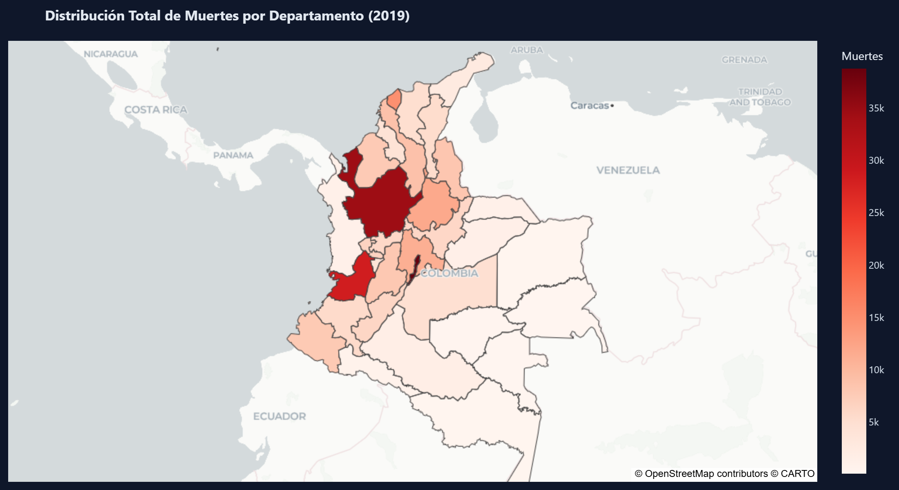
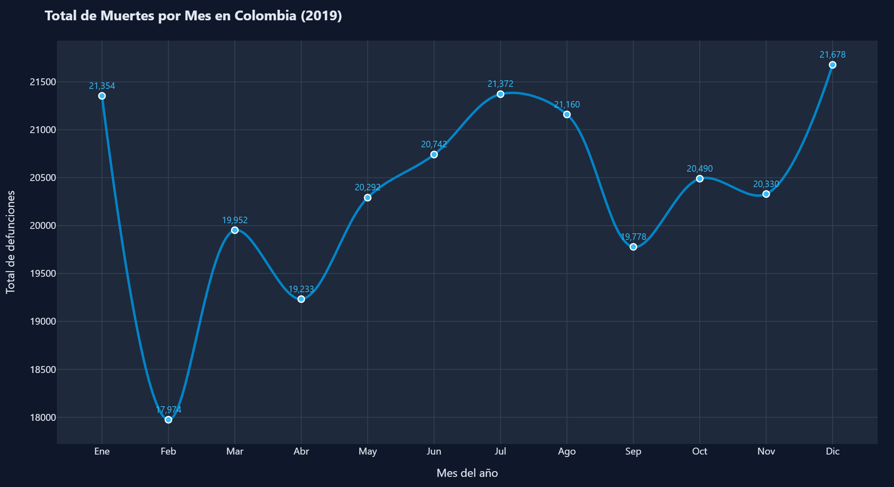
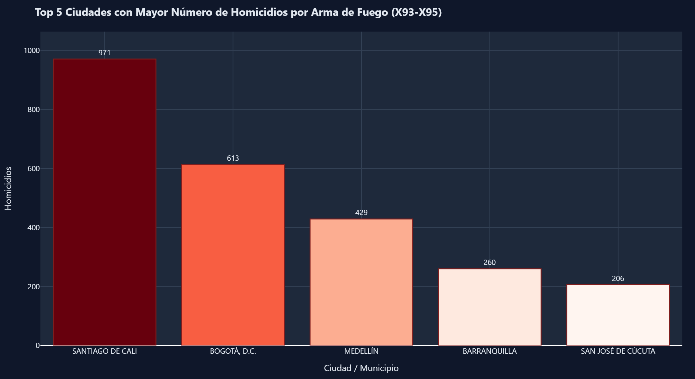
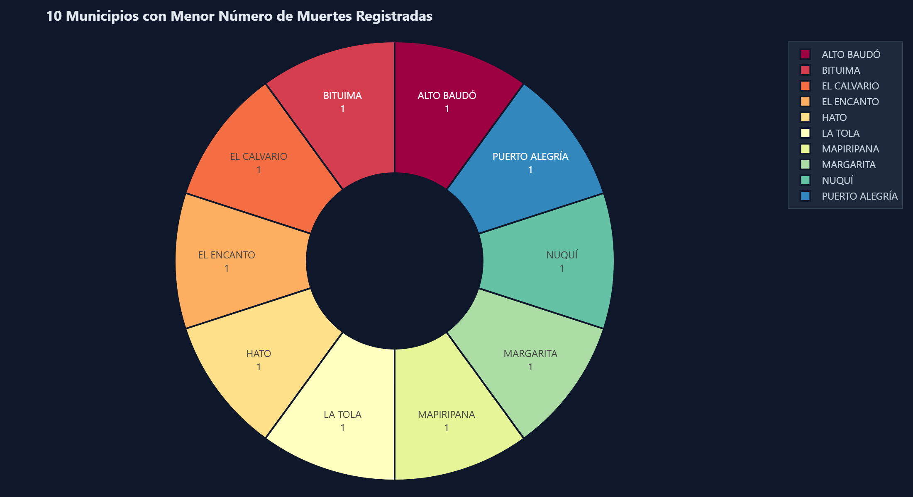
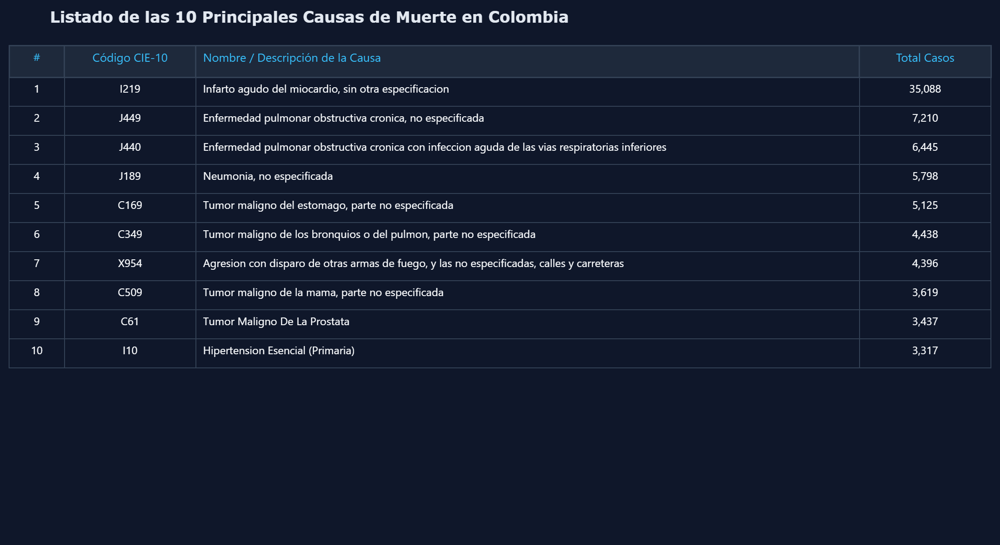
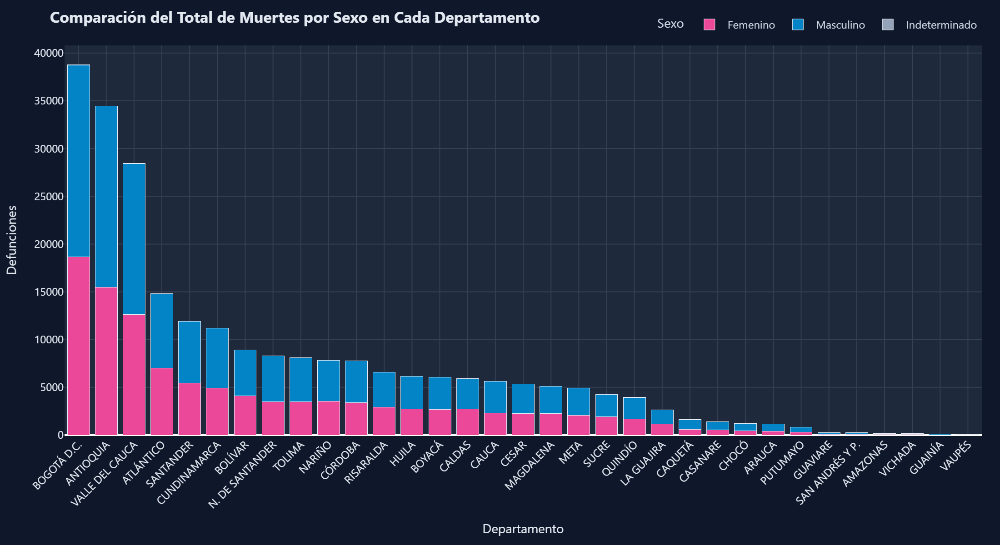
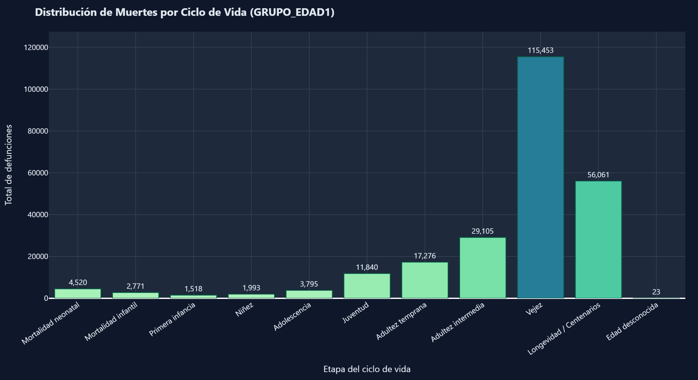

# Análisis de Mortalidad en Colombia — 2019
### Dashboard Analítico Interactivo con Python, Dash y Plotly

> 🚀 **Aplicación Desplegada en Producción (PaaS Render):**  
> 👉 [https://mortalidad-colombia-2019-leul.onrender.com/](https://mortalidad-colombia-2019-leul.onrender.com/)

---

## 1. Introducción del Proyecto

El análisis de la mortalidad es uno de los pilares fundamentales para el diseño de políticas públicas, la planificación de recursos sanitarios y la comprensión del bienestar demográfico de una nación. 

Este proyecto implementa una **aplicación web analítica dinámica e interactiva** desarrollada en **Python** utilizando los frameworks **Dash** y **Plotly**, integrando componentes de diseño con **Dash Bootstrap Components**. La plataforma procesa y visualiza la totalidad de los microdatos de **defunciones no fetales ocurridas en Colombia durante el año 2019**, publicados por el **Departamento Administrativo Nacional de Estadística (DANE)** mediante el Sistema de Estadísticas Vitales (EEVV), vinculados con la codificación de patologías de la **CIE-10 (Clasificación Estadística Internacional de Enfermedades y Problemas Relacionados con la Salud)** y la **DIVIPOLA (División Político-Administrativa de Colombia)**.

---

## 2. Objetivo

Desarrollar y desplegar en una plataforma PaaS (*Platform as a Service*) un dashboard interactivo que permita:
- Explorar patrones geoespaciales de mortalidad a nivel departamental y municipal.
- Identificar la estacionalidad y comportamiento temporal de las defunciones a lo largo de los doce meses del año 2019.
- Examinar la incidencia de la violencia armada focalizada en los municipios más afectados por homicidios con armas de fuego (códigos CIE-10 X93–X95).
- Rastrear las principales patologías y causas básicas de muerte en el territorio nacional.
- Contrastar la brecha de mortalidad por género (masculino vs. femenino) entre departamentos.
- Evaluar la transición del riesgo de defunción a lo largo del ciclo vital humano (desde la etapa neonatal hasta la longevidad y centenarios).

---

## 3. Estructura del Proyecto

El repositorio sigue una arquitectura modular y limpia, diseñada para optimizar tanto el desarrollo local como la velocidad de inicio en la nube:

```text
mortalidad_colombia_2019/
│
├── data/                                         # Almacenamiento de microdatos oficiales de la actividad
│   ├── Anexo1.NoFetal2019_CE_15-03-23.xlsx      # 1. Microdatos de defunciones no fetales DANE 2019
│   ├── Anexo2.CodigosDeMuerte_CE_15-03-23.xlsx  # 2. Catálogo patológico de códigos CIE-10 a 4 caracteres
│   ├── Divipola_CE_.xlsx                        # 3. División Político-Administrativa de Colombia
│   ├── causas_procesadas.csv.gz                 # Catálogo comprimido para inicio rápido (<1s)
│   └── mortalidad_procesada.csv.gz              # Datos procesados comprimidos compatibles con cualquier versión de Pandas
│
├── images/                                       # Capturas de alta resolución de las visualizaciones
│   ├── 1_mapa_mortalidad.png
│   ├── 2_lineas_mes.png
│   ├── 3_ciudades_violentas.png
│   ├── 4_menor_mortalidad.png
│   ├── 5_tabla_causas.png
│   ├── 6_sexo_departamento.png
│   └── 7_ciclo_vida.png
│
├── src/                                          # Código fuente modular de la aplicación
│   ├── __init__.py                              # Módulo Python
│   ├── load_data.py                             # Carga inteligente de datos (caché / fallback Excel)
│   ├── data_processing.py                       # Limpieza, transformaciones y homologación CIE-10
│   ├── figures.py                               # Construcción de las 7 visualizaciones Plotly
│   ├── layout.py                                # Interfaz gráfica Dash con Bootstrap y Tabs
│   └── app.py                                   # Aplicación Dash, callbacks reactivos y servidor WSGI
│
├── .gitignore                                    # Archivos ignorados por Git
├── app.py                                        # Punto de entrada raíz para ejecución y despliegue
├── Procfile                                      # Configuración de proceso para PaaS (Heroku / Render)
├── render.yaml                                   # Manifiesto de despliegue automatizado en Render
├── requirements.txt                              # Dependencias y librerías del proyecto
└── README.md                                     # Documentación técnica y analítica completa
```

---

## 4. Requisitos

Las dependencias requeridas para la ejecución del proyecto son:

| Librería | Versión Mínima | Propósito |
| :--- | :--- | :--- |
| **python** | `>= 3.10` | Entorno de ejecución principal |
| **dash** | `>= 2.14.0` | Framework web analítico reactivo |
| **dash-bootstrap-components** | `>= 1.5.0` | Sistema de rejilla responsive y temas modernos |
| **plotly** | `>= 5.18.0` | Motor de gráficos interactivos y mapas |
| **pandas** | `>= 1.5.0` | Manipulación, filtrado y agregación tabular |
| **numpy** | `>= 1.24.0` | Operaciones vectorizadas y condiciones lógicas |
| **openpyxl** | `>= 3.1.0` | Lector de hojas de cálculo Excel (.xlsx) |
| **gunicorn** | `>= 21.2.0` | Servidor HTTP WSGI para producción en Linux/PaaS |

---

## 5. Despliegue en la Nube (PaaS: Render)

La aplicación está completamente configurada para desplegarse de manera directa y continua en **Render** (o plataformas análogas como Railway, Fly.io o AWS App Runner):

### Pasos para Desplegar en Render:

1. **Crear una cuenta:** Registrarse o iniciar sesión en [Render.com](https://render.com).
2. **Conectar GitHub:** En el panel de Render, seleccionar **"New +"** > **"Web Service"** y conectar el repositorio de GitHub de este proyecto.
3. **Configurar los parámetros del servicio:**
   - **Name:** `mortalidad-colombia-2019`
   - **Region:** Ohio (US East) o Frankfurt (EU Central)
   - **Branch:** `main`
   - **Runtime:** `Python 3`
   - **Build Command:** `pip install -r requirements.txt`
   - **Start Command:** `gunicorn app:server --bind 0.0.0.0:$PORT`
   - **Instance Type:** `Free` (512 MB RAM, 0.1 CPU)
4. **Despliegue:** Hacer clic en **"Create Web Service"**.
   - Render clonará el repositorio, instalará las dependencias y ejecutará la aplicación con Gunicorn.
   - Gracias a los archivos optimizados `mortalidad_procesada.csv.gz` y `causas_procesadas.csv.gz`, el inicio del servicio toma solo **1 segundo**, evitando bloqueos de memoria (*Out Of Memory*) o tiempos de espera en el *health check*.
5. **URL Pública en Producción:**  
   La aplicación se encuentra disponible públicamente en:  
   👉 **[https://mortalidad-colombia-2019-leul.onrender.com/](https://mortalidad-colombia-2019-leul.onrender.com/)**

---

## 6. Software y Herramientas Utilizadas

- **Lenguaje:** [Python 3.10](https://www.python.org/)
- **Visualización Interactiva:** [Plotly Express & Plotly Graph Objects](https://plotly.com/python/)
- **Frontend / Framework:** [Dash by Plotly](https://dash.plotly.com/)
- **Diseño UI / CSS:** [Dash Bootstrap Components (Tema Darkly / Slate)](https://dash-bootstrap-components.opensource.faculty.ai/)
- **Servidor Web:** [Gunicorn](https://gunicorn.org/)
- **Control de Versiones:** [Git](https://git-scm.com/) & [GitHub](https://github.com/)
- **Plataforma de Alojamiento:** [Render (PaaS)](https://render.com/)

---

## 7. Instalación y Ejecución Local

Para clonar y poner en marcha la aplicación en un entorno local, siga los siguientes pasos:

### 1. Clonar el repositorio
```bash
git clone https://github.com/dsgonzalezb/mortalidad-colombia-2019.git
cd mortalidad-colombia-2019
```

### 2. Crear y activar un entorno virtual
```bash
# En Windows (PowerShell)
python -m venv venv
.\venv\Scripts\Activate.ps1

# En Linux / macOS
python3 -m venv venv
source venv/bin/activate
```

### 3. Instalar las dependencias
```bash
pip install -r requirements.txt
```

### 4. Ejecutar la aplicación
```bash
python app.py
```

### 5. Abrir en el navegador
Visite en su navegador web: `http://localhost:8050`

---

## 8. Visualizaciones con Explicaciones de los Resultados

A continuación, se describen los 7 elementos visuales implementados en la aplicación, acompañados de sus capturas de pantalla y los hallazgos analíticos más relevantes.

---

### 8.1. Mapa: Distribución Total de Muertes por Departamento



* **Descripción:** Visualización geoespacial interactiva utilizando mapas temáticos centrados en las coordenadas geográficas de cada departamento colombiano, donde el tamaño y color del marcador representan el volumen total de muertes acumuladas en 2019.
* **Hallazgos clave:**
  - Existe una marcada concentración de la mortalidad en las regiones andina y pacífica central. Los departamentos con mayor número de defunciones corresponden a **Antioquia**, **Bogotá D.C.** y **Valle del Cauca**, explicando en conjunto más del 40% de los decesos nacionales, lo cual refleja la densidad poblacional y la centralización de los centros de referencia hospitalaria.
  - En contraste, los departamentos de la Amazonía y Orinoquía (como Vaupés, Guainía, Vichada y Amazonas) registran cifras significativamente menores en términos absolutos, asociadas a una baja densidad demográfica pero también a retos de subregistro en áreas rurales dispersas.

---

### 8.2. Gráfico de Líneas: Mortalidad Mensual en Colombia



* **Descripción:** Serie de tiempo que muestra la fluctuación del número total de defunciones registradas a lo largo de cada uno de los 12 meses de 2019.
* **Hallazgos clave:**
  - Se observa un promedio mensual de aproximadamente **20,363 defunciones**.
  - El mes con mayor mortalidad fue **Diciembre** (21,678 casos), seguido cercanamente por **Julio** (21,372 casos) y **Enero** (21,354 casos). El incremento a final de año coincide estacionalmente con picos de eventos cardiovasculares y siniestros viales / violencia asociados a festividades.
  - El punto más bajo ocurre en **Febrero** (17,974 casos), explicado primordialmente por la menor cantidad de días del mes (28 días).

---

### 8.3. Gráfico de Barras: Top 5 Ciudades Más Violentas (Armas de Fuego)



* **Descripción:** Gráfico de barras ordenado que destaca los 5 municipios con mayor número de homicidios perpetrados con armas de fuego, considerando los códigos CIE-10 **X93, X94 y X95** (agresión con disparo de armas de fuego y casos no especificados).
* **Hallazgos clave:**
  - **Santiago de Cali** encabeza la lista nacional con **971 homicidios** por arma de fuego en 2019, superando notablemente a otras capitales de mayor tamaño poblacional.
  - En segundo lugar se ubica **Bogotá D.C.** con **613 casos**, seguida por **Medellín** con **429 casos**, **Barranquilla** con **260 casos** y **San José de Cúcuta** con **206 casos**.
  - Este indicador evidencia la urgencia de intervenciones focalizadas de seguridad y tejido social en los corredores urbanos identificados.

---

### 8.4. Gráfico Circular: 10 Municipios con Menor Índice de Mortalidad



* **Descripción:** Gráfico circular de tipo dona (*donut chart*) que expone los 10 municipios del país con menor cantidad de defunciones reportadas durante el año 2019.
* **Hallazgos clave:**
  - Municipios como **Alto Baudó**, **Bituima**, **El Calvario**, **El Encanto**, **Hato**, **La Tola**, **Mapiripana**, **Margarita**, **Nuquí** y **Puerto Alegría** presentan conteos mínimos (1 defunción registrada en el periodo analizado).
  - Estos territorios evidencian o bien una población muy reducida en zonas de difícil acceso, o la necesidad de fortalecer los mecanismos locales de certificación y reporte oportuno ante el sistema de Estadísticas Vitales.

---

### 8.5. Tabla: 10 Principales Causas de Muerte en Colombia (CIE-10)



* **Descripción:** Tabla estructurada de las 10 principales patologías que causaron la muerte de personas en Colombia en 2019, ordenadas de mayor a menor frecuencia, con su respectivo código CIE-10 oficial, denominación médica y total de casos.
* **Hallazgos clave:**
  - La causa #1 indiscutible de mortalidad en Colombia es el **Infarto agudo del miocardio, sin otra especificación (Código I219)** con un total de **35,088 defunciones**, representando por sí sola más del 14% de todas las muertes del país.
  - Las enfermedades respiratorias crónicas y agudas representan una carga masiva: **Enfermedad pulmonar obstructiva crónica (J449 con 7,210 casos y J440 con 6,445 casos)** y la **Neumonía no especificada (J189 con 5,798 casos)** ocupan los puestos 2, 3 y 4.
  - Dentro de las neoplasias malignas, el **Tumor maligno del estómago (C169)** figura como el cáncer más letal en Colombia en 2019 con **5,125 defunciones** (posición 5).

---

### 8.6. Gráfico de Barras Apiladas: Total de Muertes por Sexo en Cada Departamento



* **Descripción:** Gráfico de barras apiladas segmentado por sexo biológico (Masculino en azul, Femenino en magenta, Indeterminado en gris) para cada uno de los 33 entes territoriales de Colombia, ordenados de mayor a menor volumen total.
* **Hallazgos clave:**
  - A nivel nacional, existe un claro predominio de la mortalidad en el género **masculino (134,573 muertes; 55.08%)** frente al **femenino (109,689 muertes; 44.89%)**.
  - La sobremortalidad masculina se acentúa en departamentos con altos índices de violencia interpersonal y accidentalidad (como Antioquia, Valle del Cauca, Arauca y Norte de Santander), donde las muertes por causas externas impactan primordialmente a varones jóvenes y en edad productiva.

---

### 8.7. Histograma: Distribución de Muertes por Ciclo de Vida



* **Descripción:** Distribución de frecuencia que categoriza la variable oficial `GRUPO_EDAD1` según los rangos establecidos de la tabla de referencia demográfica, evaluando la transición epidemiológica de la población.
* **Hallazgos clave:**
  - El grupo etario con mayor concentración de fallecimientos es la **Vejez (60 a 84 años)** con **115,453 defunciones (47.25%)**, seguido de la etapa de **Longevidad / Centenarios (85 a 100+ años)** con **56,061 defunciones (22.94%)**. Juntas suman más del 70% de la mortalidad total.
  - La **Adultez intermedia (45 a 59 años)** concentra **29,105 casos (11.91%)**, mientras que la **Juventud (20 a 29 años)** acumula **11,840 muertes (4.85%)**, fuertemente influenciada por causas externas violentas.
  - La **Mortalidad neonatal (< 1 mes)** totalizó **4,520 defunciones (1.85%)** y la **Mortalidad infantil (1 a 11 meses)** registró **2,771 casos (1.13%)**, señalando focos críticos de atención perinatal en salud materno-infantil.

---

## Autor

- **Santiago González** — Estudiante Maestría en Inteligencia Artificial / Aplicaciones I

